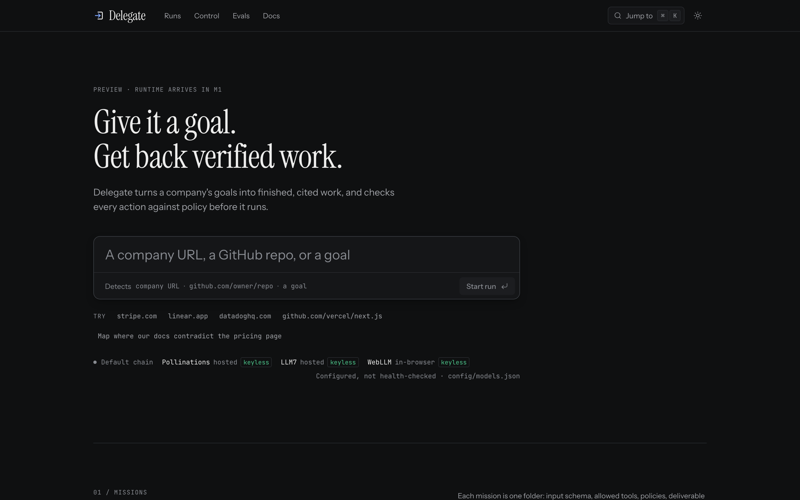
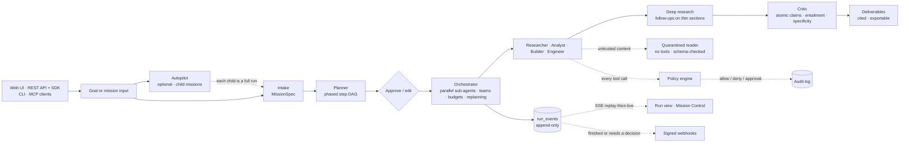
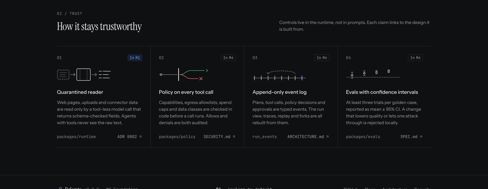

# Delegate

**Turns a goal, a company URL or a repo into finished, verified work.**

<a href="https://github.com/LiamSDD/LiamSDD/blob/main/assets/demos/delegate-demo-1080p60.mp4"></a>

[Watch the 62-second demo](https://github.com/LiamSDD/LiamSDD/blob/main/assets/demos/delegate-demo-1080p60.mp4): real live runs on free models, with only the waiting sped up.

## Why

- **Agents run in parallel** on a plan you approve or edit first.
- **Every claim is checked** against its source and cited.
- **Risky actions wait for approval**; every tool call passes a policy engine and is audited.
- **Every run is an event log** you can replay, fork from any step and compare.
- **Runs for $0** on free models, with no keys and no sign-up.

## Quick start

```bash
pnpm install
pnpm dev          # web app on http://localhost:3000
pnpm check        # typecheck, lint, test and build
```

Needs Node 26 and pnpm 12. No keys needed.

**[Live demo](https://delegate-beryl.vercel.app)** (no sign-up) · **[Docs](https://delegate-beryl.vercel.app/docs)** · **[Case study](docs/CASE_STUDY.md)** · [Evals](https://delegate-beryl.vercel.app/evals)

## Status

- M0–M5 shipped; M6 platform interfaces shipped except Ops Pulse; M7 in progress.
- Five missions and Autopilot run live end to end. Ship-a-PR is built and off on the public demo.
- Latest live X-ray eval: 81% pass (95% CI 57–93%, n=16), p50 62 s, $0.
- 2,700 tests. Every number here comes from code or committed result files; see [`/evals`](https://delegate-beryl.vercel.app/evals) and [`docs/PROGRESS.md`](docs/PROGRESS.md).

## What you can delegate

| Mission | Input | Deliverable | Live demo |
|---|---|---|---|
| Company X-ray | Company URL | Cited brief: offering, customers, market, competitors, positioning, news, SWOT, stack signals | Live |
| AI Automation Audit | Company URL, optional department | 5–8 workflows to automate, ranked by an adjustable ROI model | Live |
| Build it | An Audit opportunity | A cited assistant trained on the company's site, with an eval set, a gaps report and an embeddable widget | Live |
| Repo X-ray | Public GitHub URL | Architecture map, hotspots, test gaps and ranked improvements, cited to `path:line` | Live |
| Ship-a-PR | A Repo X-ray improvement, an authorised repo | The change made and tested in a sandbox; a pull request only after a person approves the exact diff | Built; off |
| Custom goal | A goal in plain language | Cited brief with findings by workstream, a ranked action plan and risks | Live |
| Autopilot | A goal | The goal brief, up to three follow-up missions with their own approvals, and a final report | Live |

<picture>
  <source media="(prefers-color-scheme: dark)" srcset="docs/images/home-dark.png">
  <source media="(prefers-color-scheme: light)" srcset="docs/images/home-light.png">
  
</picture>

## Runs for $0

- No paid API and no accounts by default ([ADR 0003](docs/adr/0003-zero-cost-model-routing.md)).
- Each role (planner, worker, fast) has a fallback chain: keyless hosted models, then in-browser WebGPU, then local Ollama.
- Optional: free-tier keys (Kimi K3, DeepSeek, Groq, Cerebras) or Claude with your own key.
- The router falls back on rate limits, stalls and errors; every step records which model served it.

## Architecture



- **Hand-written agent runtime**, no framework ([ADR 0001](docs/adr/0001-hand-written-runtime.md)). The loop is about 170 lines.
- **Quarantined reader** (dual-LLM pattern): instructions hidden in a web page have nothing to talk to ([ADR 0002](docs/adr/0002-quarantined-reader.md)).
- **Event log as the source of truth:** UI, traces, replay, forks and crash recovery are all rebuilt from typed `RunEvent`s.

More: [architecture](docs/ARCHITECTURE.md) · [threat model](docs/SECURITY.md) · [decisions](docs/adr) (20 ADRs).

<picture>
  <source media="(prefers-color-scheme: dark)" srcset="docs/images/trust-dark.png">
  <source media="(prefers-color-scheme: light)" srcset="docs/images/trust-light.png">
  
</picture>

<details>
<summary><b>Capabilities</b></summary>

| Capability | What it does | Where |
|---|---|---|
| Missions | Company X-ray, AI Automation Audit, Build it, Repo X-ray, Ship-a-PR and custom goals, each with an input schema, allowed capabilities, a deliverable schema and an eval dataset. | [`packages/runtime/src/missions`](packages/runtime/src/missions), [guide](docs/guides/missions.md) |
| Planner, orchestrator, critic | Validated step DAG with phases, plan approval and editing, parallel sub-agents with per-step budgets, capped replanning, and a critic that checks atomic claims against whole quotes. A revision that widens capabilities always waits for a person. | [ADR 0006](docs/adr/0006-planner-orchestrator-critic.md), [ADR 0015](docs/adr/0015-deep-research-and-specificity.md) |
| Deep research | Bounded follow-up rounds on sections with thin evidence; generic claims are moved to context or dropped, and specificity is reported next to citation accuracy. | [ADR 0015](docs/adr/0015-deep-research-and-specificity.md) |
| Autopilot | A coordinator run that starts a custom goal, then up to three child missions from its ranked actions. Each child keeps its own approvals; depth is one by construction. | [ADR 0016](docs/adr/0016-autopilot.md) |
| Agent teams | A plan step may declare a bounded fan-out of members with their own budgets, a typed run blackboard, a self-check before hand-off, and one typed-output path with repair. | [ADR 0020](docs/adr/0020-agent-teams-and-learned-routing.md) |
| Durable runs, fork, replay, compare | Runs resume from the event log after a crash; any step can be forked; recorded runs replay; two runs diff claim by claim. | [ADR 0007](docs/adr/0007-durable-runs-from-the-event-log.md), [ADR 0009](docs/adr/0009-fork-replay-compare.md) |
| Trust layer | Policy engine on every tool call, SSRF-hardened fetch, quarantined reader, PII redaction in the event emitter, audit log, and a red-team suite that runs in the local gate. | [`docs/SECURITY.md`](docs/SECURITY.md), [guide](docs/guides/red-team.md) |
| Evals and training | Datasets for five missions with committed live results, Wilson and t intervals, Pareto chart and judge calibration on `/evals`; `pnpm evolve` and `pnpm train` promote a prompt or playbook only on a paired, significant win; `pnpm route:learn` derives model order from per-trial evidence. No training round or learned routing file is committed yet. | [`packages/evals`](packages/evals), [ADR 0021](docs/adr/0021-training-loop.md) |
| Evolving playbooks | Typed lessons from each finished run, per workspace and per house, shown to the planner with their scores. | [ADR 0013](docs/adr/0013-evolving-playbooks.md) |
| Mission Control | Approvals inbox across runs, active runs with their current step, usage, and two safety switches: pause new runs (enforced in the database) and stop all runs. | [ADR 0019](docs/adr/0019-mission-control-and-settings.md) |
| Settings | API tokens, MCP connectors and GitHub, webhook endpoints, the policy sets with a dry run, automation defaults, and workspace export and deletion. | [ADR 0019](docs/adr/0019-mission-control-and-settings.md) |
| Platform interfaces | REST API v1 (bearer tokens, idempotency keys, one error envelope, OpenAPI 3.1 at `/api/v1/openapi.json`), a typed SDK, the `delegate` CLI, and HMAC-signed webhooks with retries. | [ADR 0018](docs/adr/0018-platform-interfaces.md), [API](docs/guides/api.md), [CLI](docs/guides/cli.md), [webhooks](docs/guides/webhooks.md) |
| MCP | Remote MCP server at `/api/mcp` for Claude Code, Codex, Cursor and VS Code; MCP client connectors whose output goes through the quarantined reader and whose side-effecting tools ask for approval. | [ADR 0014](docs/adr/0014-connections.md) |
| Docs site | The guides in [`docs/guides`](docs/guides), served at [`/docs`](https://delegate-beryl.vercel.app/docs) with search. | [`apps/web`](apps/web) |

</details>

<details>
<summary><b>Packages and tests</b> (2,700 in total)</summary>

| Package | What it does | Tests |
|---|---|---|
| [`packages/runtime`](packages/runtime) | Agent loop, model router with fallback and rotation, adapters, quarantined reader, crawl engine and keyless research tools, missions, planner, orchestrator, critic, deep research, teams, Autopilot, durable resume, sandbox, MCP client, playbooks, PII redaction, OpenTelemetry. | 1,138 |
| [`apps/web`](apps/web) | Next.js app: home, run view with live events, plan approval, lanes, trace, replay, fork and compare; assistants and the embed widget; `/evals`; Mission Control and audit log; Settings; docs site; REST v1 and MCP route handlers. | 811 |
| [`packages/db`](packages/db) | Postgres schema and migrations with FORCE row-level security on every tenant table, a non-owner app role, `SECURITY DEFINER` write paths, append-only event and audit logs, idempotency keys, webhook deliveries, the pause switch and workspace erasure. | 257 |
| [`packages/evals`](packages/evals) | Eval harness, datasets, graders and judge, statistics, red-team suite, `evolve`, `train` and `route:learn`. | 195 |
| [`packages/sdk`](packages/sdk) | The v1 contract as zod schemas, OpenAPI generation, the typed client with SSE, and webhook verification. | 95 |
| [`packages/policy`](packages/policy) | Declarative policy engine that fails closed: side effects need approval, egress needs an allowlisted target, private and metadata hosts are blocked. | 83 |
| [`scripts`](scripts) | Secret scanner (pre-commit) and git hooks. | 79 |
| [`packages/cli`](packages/cli) | `delegate login`, `run --watch`, `runs`, plan decisions and artifacts. | 34 |
| [`packages/mcp-server`](packages/mcp-server) | MCP tools and resources over the REST backend, for HTTP and stdio. | 8 |
| **Total** | | **2,700** |

Counted on `main` with `vitest run` in each package and `vitest run --dir scripts` at the root; `pnpm check` runs the same suites before every push.

</details>

## Connect from Claude Code or Codex

Delegate is a remote MCP server at `https://<host>/api/mcp`. Create a token under **Settings → Connections**, which also shows setup for Cursor, VS Code and other clients.

```bash
# Claude Code
claude mcp add --transport http delegate https://<host>/api/mcp \
  --header "Authorization: Bearer <your-delegate-token>"
```

```toml
# Codex: ~/.codex/config.toml, with DELEGATE_TOKEN exported in your shell
[mcp_servers.delegate]
url = "https://<host>/api/mcp"
bearer_token_env_var = "DELEGATE_TOKEN"
```

- Then ask your agent to "run a company X-ray on acme.com with Delegate".
- Tools: `start_mission`, `get_run`, `wait_for_run`, `approve_plan`, `reject_plan`, `list_runs`, `get_artifact`. Deliverables are also resources (`delegate://runs/{runId}/deliverable`).
- Runs started over MCP stream live in the web UI and go through the same policies, approvals, quotas and audit log.
- Stdio-only clients: `DELEGATE_URL=https://<host> DELEGATE_TOKEN=<token> pnpm --filter @delegate/mcp-server stdio`.
- The same page connects your own MCP servers and GitHub repositories ([ADR 0014](docs/adr/0014-connections.md)).

Full guide: [connect MCP clients](docs/guides/connect-mcp-clients.md).

## Use it from a terminal or your code

The same token works for the REST API, the SDK and the CLI.

```bash
pnpm delegate login --api-url https://<host>
pnpm delegate run repo-xray https://github.com/vercel/next.js --watch
```

```ts
import { createDelegateClient } from "@delegate/sdk";

const delegate = createDelegateClient({ baseUrl: process.env.DELEGATE_URL ?? "", token: process.env.DELEGATE_TOKEN ?? "" });
const run = await delegate.runs.create({ missionId: "company-xray", input: { url: "https://acme.com" } });
```

Guides: [API](docs/guides/api.md) · [CLI](docs/guides/cli.md) · [webhooks](docs/guides/webhooks.md) (HMAC-SHA256, verified with `verifyWebhook` from `@delegate/sdk/webhooks`) · [self-hosting](docs/guides/self-hosting.md) · optional providers in [`.env.example`](.env.example).

<details>
<summary><b>Roadmap</b></summary>

| Milestone | Scope | Status |
|---|---|---|
| M0 · Foundation | Monorepo, data model with RLS, events, router, policy, evals stats, design system | Done |
| M1 · Runtime + Company X-ray | Streaming tool-use loop, quarantined reader, run view on live events, first eval dataset | Done |
| M2 · Multi-agent + Automation Audit | Planner DAG, parallel lanes, critic, interactive ROI model, trace waterfall | Done; the five-company exit check is not recorded yet |
| M3 · Build it + durability | Build-an-Agent (crawler, hybrid RAG, widget), durable runs, approvals | Done; the Demo A exit check is not recorded yet |
| M4 · Trust layer | Red-team suite, replay, fork-from-step, `/evals` scoreboard | Done |
| M5 · Engineering missions | Repo X-ray, Ship-a-PR in a sandbox | Done; Ship-a-PR has not opened a live pull request yet |
| M6 · Platform interfaces | REST API, SDK, webhooks, CLI, MCP server and connectors, Ops Pulse | Shipped except Ops Pulse |
| M7 · Enterprise | RBAC + SSO, policy editor, Mission Control, standing missions, self-hosting | In progress: Mission Control, Settings with a policy dry run, BYOK Claude and member roles in row-level security are in; SSO, policy editing, standing missions and Bedrock/Vertex are not |
| M8 · Launch polish | Load test, accessibility audit, demo videos | Planned |

Shipped beyond the original plan: Autopilot, deep research, agent teams, evolving playbooks and the training loop. Next: Studio, which takes an idea to a working product. Full spec and demo scripts: [`SPEC.md`](SPEC.md), [`docs/DEMO_SCRIPT.md`](docs/DEMO_SCRIPT.md).

</details>

## Built with Claude Code

The workflow is part of the project; the [case study](docs/CASE_STUDY.md) explains it.

- [`CLAUDE.md`](CLAUDE.md): the working agreement every session reads.
- [`.claude/commands/`](.claude/commands): `next-task`, `verify`, `eval`, `redteam`, `demo-check`, `adr`.
- [`.claude/agents/`](.claude/agents): `code-reviewer`, `security-reviewer`, `eval-analyst`, `ux-critic`.
- Hooks: lint on every edit, secret scan before every commit, full check before every push.
- Independent workstreams run as parallel sub-agents, then get reviewed before merge.

## Contributing

[Contributing guide](CONTRIBUTING.md) · [security policy](SECURITY.md) · [code of conduct](CODE_OF_CONDUCT.md)

## License

MIT
