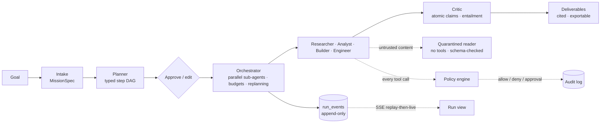

# Delegate

**Turns a company's goals into finished, verified work, safely enough for an enterprise to let it run.**

Paste a company URL, a GitHub repo or a goal. Delegate plans the work, runs specialist agents in parallel, verifies every claim against its source, asks before anything risky happens, and records every step so the run can be replayed, forked and evaluated.

<picture>
  <source media="(prefers-color-scheme: dark)" srcset="docs/images/home-dark.png">
  <source media="(prefers-color-scheme: light)" srcset="docs/images/home-light.png">
  
</picture>

**Live demo: [delegate-beryl.vercel.app](https://delegate-beryl.vercel.app)**. Paste a company URL and watch the agents work. Free models, $0, no sign-up.

> **Status: M4 shipped.** Company X-ray, AI Automation Audit and Build it run live end to end on free NVIDIA-hosted models with a keyless fallback. The trust layer is in: a 56-attack red-team suite at 0% attack success in the local gate, fork from any step, replay and run compare from the event log, PII redaction, an audit log, and an [`/evals`](https://delegate-beryl.vercel.app/evals) scoreboard with confidence intervals. Latest live X-ray eval: 81% pass (95% CI 57–93%, n=16), p50 61 s, $0. 1,310 tests. Every number on this page comes from code in this repo; see [`docs/PROGRESS.md`](docs/PROGRESS.md).

## Why it exists

A demo agent that does impressive things is common. What enterprises actually pay for is the hard part around it:

| | What Delegate does |
|---|---|
| **Value** | Work specific to the company: a cited Company X-ray, an AI Automation Audit with an adjustable ROI model, and "Build it", which turns the top opportunity into a working cited assistant. |
| **Trust** | Every claim is cited and checked. Untrusted content is read only by a quarantined, tool-less model. Every tool call passes a policy engine; risky actions need approval; everything is audited. |
| **Operability** | Every run is an append-only event log: replayable, forkable from any step, traced with OpenTelemetry, costed, and regression-tested with statistics. |
| **Integration** | MCP server (call it from Claude Code), REST API and SDK, signed webhooks, self-hosting with Docker Compose, bring-your-own key. |

## Runs for $0

Delegate needs no paid API and no accounts by default ([ADR 0003](docs/adr/0003-zero-cost-model-routing.md)). Each role (planner, worker, fast) has a fallback chain: keyless hosted open-weight models, then in-browser models on WebGPU, then local models with Ollama. Free-tier keys (Kimi K3, DeepSeek, Groq, Cerebras) and Claude with your own key are optional extras. The router falls back on rate limits, stalls and errors, and every step records which model served it.

## Architecture



- **Hand-written agent runtime** on the Messages API, no agent framework ([ADR 0001](docs/adr/0001-hand-written-runtime.md)). The loop is meant to be read in one sitting.
- **Quarantined reader** (dual-LLM pattern) so instructions hidden in a web page have nothing to talk to ([ADR 0002](docs/adr/0002-quarantined-reader.md)).
- **Event log as the single source of truth:** the UI, traces, replay and forks are all rebuilt from typed `RunEvent`s.

Full design: [`docs/ARCHITECTURE.md`](docs/ARCHITECTURE.md). Threat model: [`docs/SECURITY.md`](docs/SECURITY.md).

<picture>
  <source media="(prefers-color-scheme: dark)" srcset="docs/images/trust-dark.png">
  <source media="(prefers-color-scheme: light)" srcset="docs/images/trust-light.png">
  
</picture>

## What is built (M0)

| Package | What it does | Tests |
|---|---|---|
| [`packages/db`](packages/db) | Postgres schema (13 tables, pgvector + full-text). Row-level security forced on every tenant table; the app connects as a non-owner role. Approvals, audit entries, usage totals and demo retention change only through locked-down functions; event and audit logs are append-only. | 170 |
| [`packages/runtime`](packages/runtime) | 20-type `RunEvent` union and a fold that rebuilds run state from events; keyless-first model config; router with fallback, health, timeouts and bounded stream parsing; OpenAI-compatible and Anthropic adapters; budgets in micro-dollars; OpenTelemetry GenAI spans. | 153 |
| [`packages/policy`](packages/policy) | Declarative policy engine that fails closed: side-effect tools need approval, outbound requests need an allowlisted target, private and metadata hosts are blocked, unclassified data is treated as restricted. | 69 |
| [`packages/evals`](packages/evals) | t and Wilson confidence intervals, a one-sided Welch regression test, eval schemas. | 48 |
| [`apps/web`](apps/web) | Next.js app: design system, home page, ⌘K palette, nonce-based CSP and security headers. | 123 |
| [`scripts`](scripts) | Secret scanner (pre-commit) and git hooks; `pnpm check` runs before every push. | 79 |

Two independent reviews (code and security) ran on M0; all findings, including three high-severity database issues, were fixed with a failing test first.

## Roadmap

| Milestone | Scope | Status |
|---|---|---|
| M0 · Foundation | Monorepo, data model with RLS, events, router, policy, evals stats, design system | Done |
| M1 · Runtime + Company X-ray | Streaming tool-use loop, quarantined reader, run view on live events, first eval dataset | Next |
| M2 · Multi-agent + Automation Audit | Planner DAG, parallel lanes, critic, interactive ROI model, trace waterfall | Planned |
| M3 · Build it + durability | Build-an-Agent (crawler, hybrid RAG, widget), durable runs, approvals | Planned |
| M4 · Trust layer | Red-team suite, replay, fork-from-step, `/evals` scoreboard | Planned |
| M5 · Engineering missions | Repo X-ray, Ship-a-PR in a sandbox | Planned |
| M6 · Platform interfaces | REST API, SDK, webhooks, CLI, MCP server and connectors | Planned |
| M7 · Enterprise | RBAC + SSO, policy editor, Mission Control, self-hosting | Planned |
| M8 · Launch polish | Load test, accessibility audit, demo videos | Planned |

The full spec, including both demo scripts, is in [`SPEC.md`](SPEC.md) and [`docs/DEMO_SCRIPT.md`](docs/DEMO_SCRIPT.md).

## Built with Claude Code

This repo is developed with Claude Code as a disciplined engineering team, and the workflow is part of the project:

- [`CLAUDE.md`](CLAUDE.md): the working agreement every session reads (rules with their reasons, definition of done, model facts).
- [`.claude/commands/`](.claude/commands): `next-task`, `verify`, `eval`, `redteam`, `demo-check`, `adr`.
- [`.claude/agents/`](.claude/agents): `code-reviewer`, `security-reviewer`, `eval-analyst`, `ux-critic`.
- Hooks: lint on every edited file, secret scan before every commit, full check before every push.
- Independent workstreams run as parallel sub-agents, each scoped to its own packages, then reviewed before merge.

## Connect from Claude Code / Codex

Delegate is a remote MCP server at `https://<host>/api/mcp` (Streamable HTTP). Create a workspace API token under **Settings → Connections**, which also shows ready-to-paste setup for Cursor, VS Code and any MCP client.

```bash
# Claude Code
claude mcp add --transport http delegate https://<host>/api/mcp \
  --header "Authorization: Bearer <your-delegate-token>"
```

```toml
# Codex: ~/.codex/config.toml, with DELEGATE_TOKEN exported in your shell
[mcp_servers.delegate]
url = "https://<host>/api/mcp"
bearer_token_env_var = "DELEGATE_TOKEN"
```

Then ask your agent to "run a company X-ray on acme.com with Delegate". The tools are `start_mission`, `get_run`, `wait_for_run`, `approve_plan`, `reject_plan`, `list_runs` and `get_artifact`; deliverables are also resources (`delegate://runs/{runId}/deliverable`). Runs started over MCP stream live in the web UI and go through the same policies, approvals, quotas and audit log. For stdio-only clients: `DELEGATE_URL=https://<host> DELEGATE_TOKEN=<token> pnpm --filter @delegate/mcp-server stdio`.

The same page connects your own MCP servers (tools are listed on connect; side-effecting tools ask for approval unless you pre-approve them) and your GitHub repositories. Design and threat model: [ADR 0014](docs/adr/0014-connections.md).

## Run it locally

```bash
pnpm install
pnpm dev          # web app on http://localhost:3000
pnpm check        # typecheck, lint, test and build across the monorepo
```

Requires Node 26 and pnpm 12. No keys are needed. See [`.env.example`](.env.example) for optional providers.

## License

MIT
