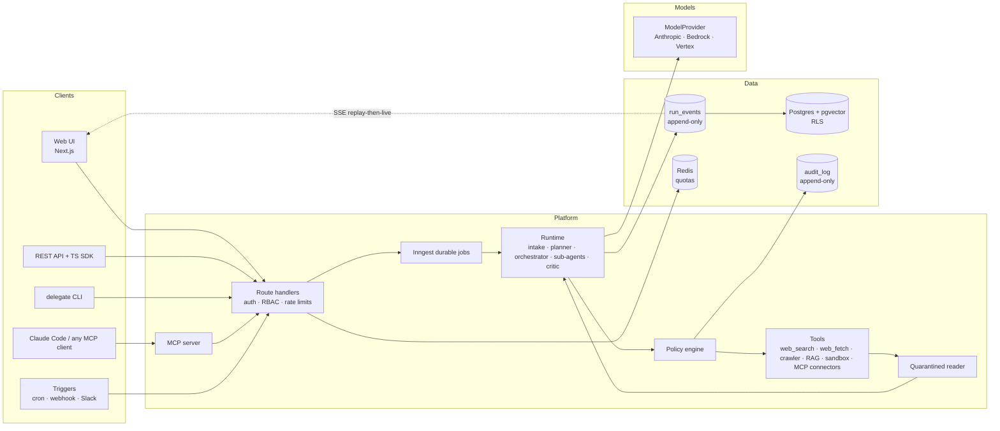
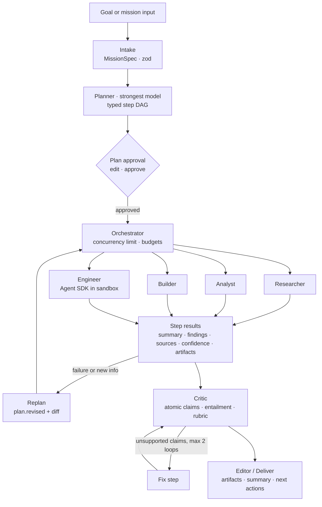
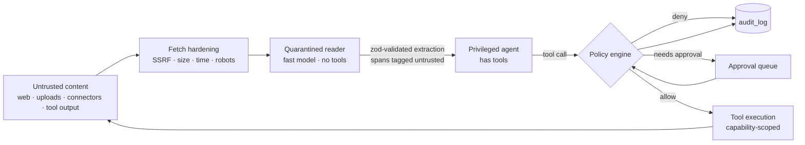
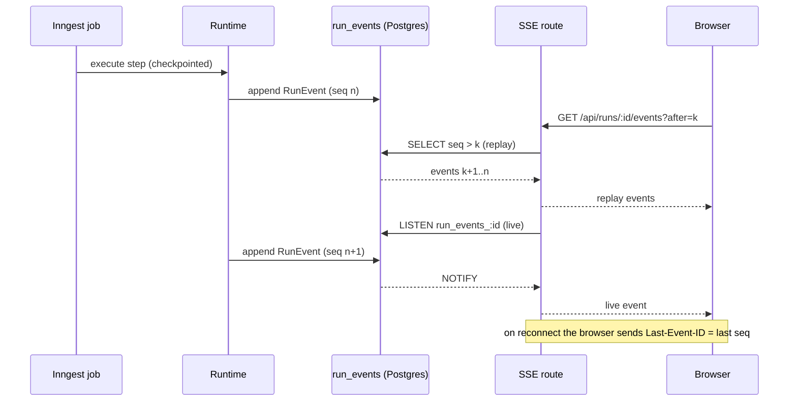
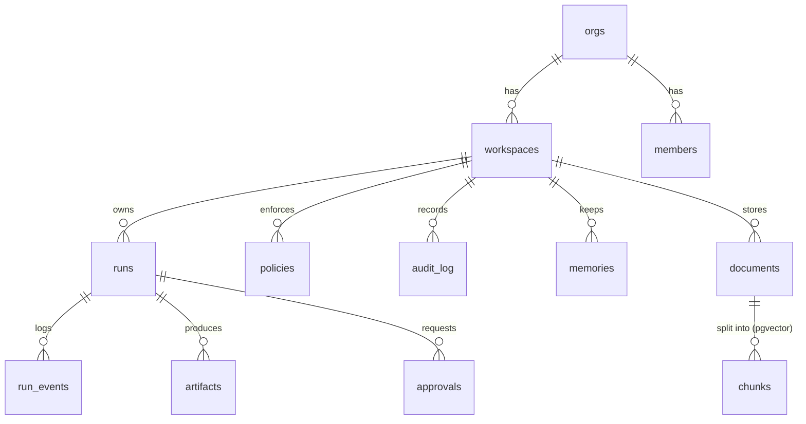

# Architecture

Delegate is a hand-written agent runtime on the Anthropic Messages API, wrapped in the controls an enterprise needs before it lets agents act: a policy engine on every tool call, a quarantined reader for untrusted content, an append-only event log, and durable jobs. This document describes the target architecture; `docs/PROGRESS.md` says what exists today.

## System overview

## Runtime pipeline

**Contracts**

- `MissionSpec`: mission id, validated input, workspace, budget, policy set, requested deliverables.
- `PlanStep`: `{ id, role, objective, inputs: StepRef[], capabilities: Capability[], acceptance: string[], budgetShare }`. The planner emits it through structured outputs; the orchestrator refuses any step whose capabilities exceed what the mission allows.
- `StepResult`: `{ summary, findings[], sources[], confidence, artifacts[] }`. Sub-agent transcripts stay in the trace and never flow into another agent's context.
- Sub-agents run in isolated contexts. They share state only through step results and the run scratchpad.

**Model routing** (`packages/runtime/src/models.ts`)

| Role | Model | Why |
|---|---|---|
| Planner, synthesis, Editor | `claude-opus-5-5` | Plan quality and final writing dominate perceived quality |
| Researcher, Analyst, Builder, Critic scoring | `claude-sonnet-5-5` | Strong tool use at a fifth of Opus input cost |
| Quarantined reader, extraction, entailment, tool-output summaries | `claude-haiku-5-5` | High volume, narrow tasks |
| Engineer | Claude Agent SDK (model set per mission) | See ADR 0003 (M5) |

Every call goes through `ModelProvider`, so the same roles run on the Anthropic API, Bedrock or Vertex with the customer's own credentials.

**Context engineering**

- Cache breakpoints: (1) end of tool definitions + system prompt, (2) end of mission context, (3) last turn of the growing conversation. Volatile data (timestamps, ids) only after the last breakpoint.
- Tool outputs over a size threshold are summarised by the fast model before re-entering context; the raw output is stored as an artifact referenced from the trace.
- Each run has a scratchpad (`memories` rows scoped to the run) that agents write to with a tool instead of carrying notes in context.
- Each step has a token budget; the orchestrator stops a step that exceeds it and emits `usage.updated` + a budget event.

## Security model

The privileged agent never sees raw untrusted text, so instructions hidden in a page have nothing to talk to. Even if an extraction smuggles intent through, every tool call still has to pass the capability check and the policy engine, which are code, not prompts. Details and threat list: `docs/SECURITY.md`.

## Event stream

- `run_events` is append-only (no UPDATE/DELETE grants) with a per-run monotonically increasing `seq`. Every UI view, trace, metric, replay and fork is derived from it.
- Event types: `run.created, plan.proposed, plan.approved, plan.revised, step.started, agent.spawned, agent.message, tool.called, tool.result, policy.decided, artifact.created, artifact.updated, critic.flagged, approval.requested, approval.resolved, usage.updated, step.completed, run.completed, run.failed`.
- **Replay:** re-execute a run with `tool.result` events served from the log instead of the network, for deterministic debugging.
- **Fork from step N:** copy events up to step N's checkpoint into a new run, change prompt version, model or input, continue live, then diff output, cost and quality.

## Data model

Every tenant table carries `workspace_id`; row-level security restricts reads and writes to workspaces the current member belongs to (`app.current_member_id` set per transaction). `run_events` and `audit_log` are insert-only.

## Observability

Each model call, tool call and policy decision is an OpenTelemetry span following the GenAI semantic conventions (`gen_ai.request.model`, `gen_ai.usage.input_tokens`, `gen_ai.usage.output_tokens`, plus cache read/write tokens). Spans export over OTLP to Langfuse, Datadog or Honeycomb; the built-in waterfall reads the same data from `run_events`, so the product works without an external backend.
